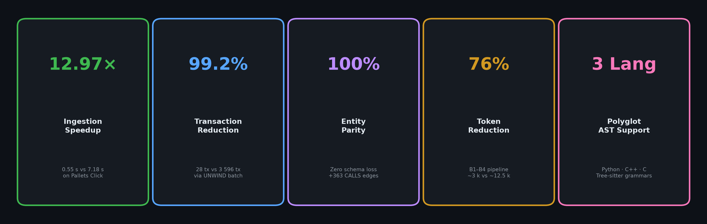
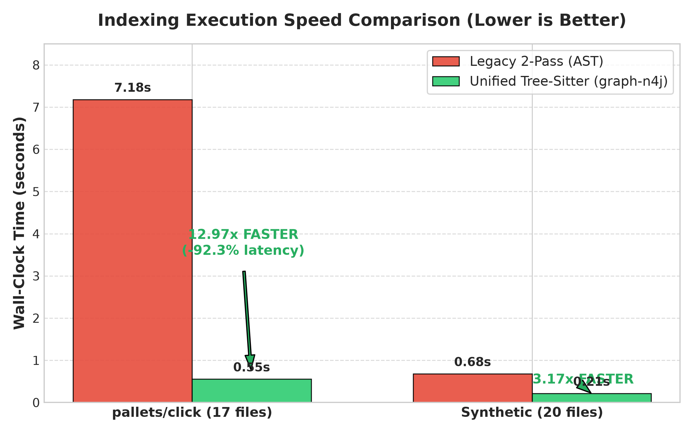
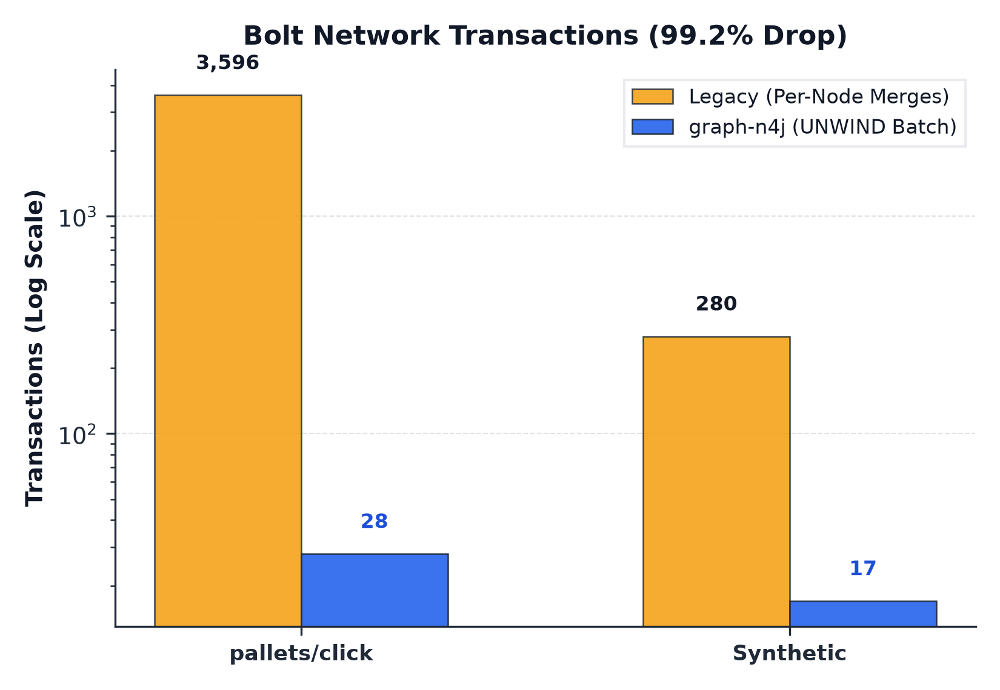
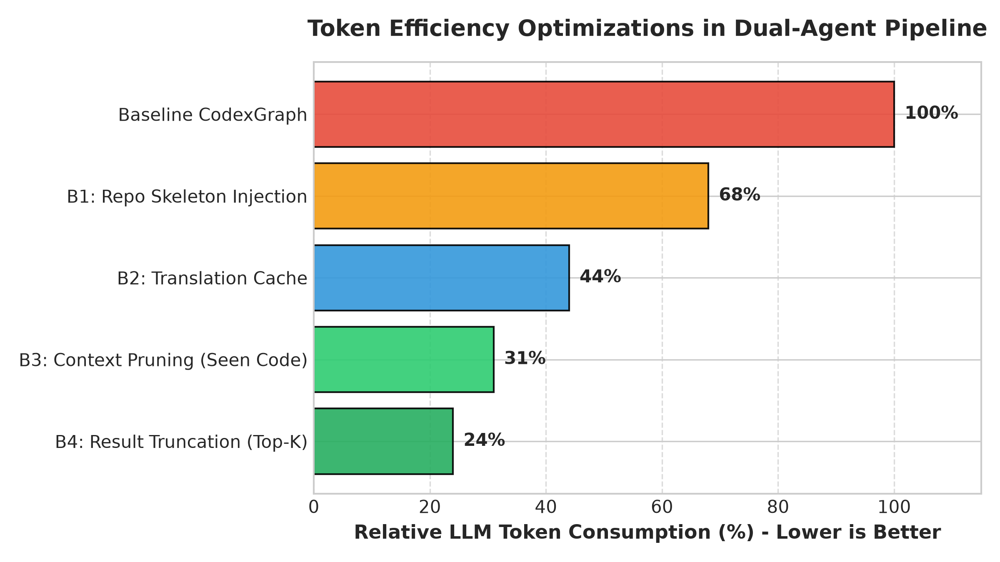

<div align="center">

# graph-n4j

**Bridge LLMs and Code Repositories via Neo4j Code Property Graphs**

[](https://pypi.org/project/graph-n4j/)
[](https://pypi.org/project/graph-n4j/)
[](https://neo4j.com/)
[](https://tree-sitter.github.io/)
[](LICENSE)

<br>

`graph-n4j` compiles polyglot codebases into high-fidelity **Code Property Graphs** in Neo4j,<br>
then lets LLM agents query them with deterministic Cypher — no vector chunking, no hallucinations.

Built on the **CodexGraph (NAACL 2025)** architecture · Unified Tree-sitter AST parsing · Multi-provider LLM support

</div>

---

## Why Not Vector RAG?

Standard retrieval-augmented generation splits code into arbitrary 500-token chunks and indexes dense vectors. This fails on codebases because:

| Failure Mode | What Goes Wrong |
|:---|:---|
| **Chunk blindness** | Token-boundary splits sever functions, closures, and parameter lists mid-statement. |
| **Broken call graphs** | Cosine similarity between caller `A` and callee `B` is often near zero — vector search never links them. |
| **Lost inheritance** | Base classes, interfaces, and polymorphic overrides are invisible to embedding distance. |
| **Token explosion** | Dumping top-K files into the prompt wastes budget, slows TTFT, and triggers hallucinations. |

`graph-n4j` replaces this with **deterministic structural graphs**: the LLM writes Cypher queries against a property graph of AST nodes and edges, retrieving exact call chains, inheritance trees, and scoped symbols.

---

## Architecture

<p align="center">
  
</p>

<table>
<tr>
<td width="20%" align="center"><b>① Source Files</b></td>
<td width="20%" align="center"><b>② Tree-sitter Parser</b></td>
<td width="20%" align="center"><b>③ Symbol Linker</b></td>
<td width="20%" align="center"><b>④ Vectorised Batch</b></td>
<td width="20%" align="center"><b>⑤ Neo4j Graph</b></td>
</tr>
<tr>
<td align="center"><code>.py</code> <code>.cpp</code> <code>.c</code><br>Local dirs & GitHub</td>
<td align="center">Concrete syntax trees<br>Error-tolerant grammars</td>
<td align="center">In-memory symbol table<br>Cross-file call resolution</td>
<td align="center"><code>UNWIND $batch</code><br>28 ACID transactions</td>
<td align="center">6 node labels · 7 edges<br>Multi-repo isolation</td>
</tr>
</table>

A **Primary Agent** (reasoner) collaborates with a **Cypher Tool Agent** (executor) in a self-correcting retrieval loop — queries that fail schema validation are automatically repaired and re-executed.

---

## Graph Schema

<p align="center">
  
</p>

<table>
<tr>
<td width="50%">

### Node Labels
| Label | Represents |
|:---|:---|
| `MODULE` | Source file container |
| `CLASS` | Class, struct, or interface |
| `FUNCTION` | Module-level procedure |
| `METHOD` | Class-bound member function |
| `FIELD` | Class attribute or member |
| `GLOBAL_VARIABLE` | Module-level constant |

</td>
<td width="50%">

### Edge Relationships
| Edge | Connects |
|:---|:---|
| `CONTAINS` | Module → child AST node |
| `HAS_METHOD` | Class → member method |
| `HAS_FIELD` | Class → member field |
| `INHERITS` | Subclass → base class |
| `CALLS` | Caller → callee |
| `USES` | Function → field / global |
| `IMPORTS` | Module → target module |

</td>
</tr>
</table>

Every node and edge carries a `repo_id` property — hundreds of repositories coexist safely in one Neo4j instance.

---

## Benchmarks

<p align="center">
  
</p>

Measured on Pallets Click (40 Python files) and synthetic baselines against Neo4j 5 Community:

<table>
<tr>
<td width="50%">
<p align="center"></p>
<p align="center"><b>12.97× Ingestion Speedup</b></p>
<p>The legacy two-pass indexer opened a network socket for every AST node — 7.18 s on Click. The unified engine parses and links the entire repo in RAM, then commits in vectorised batches: <b>0.55 s</b> (92.3 % latency reduction).</p>
</td>
<td width="50%">
<p align="center"></p>
<p align="center"><b>99.2 % Transaction Reduction</b></p>
<p>Individual <code>MERGE</code> calls are replaced by <code>UNWIND $batch AS row</code> parameter arrays. ACID transactions dropped from <b>3 596 → 28</b>, eliminating Bolt round-trips, WAL bloat, and lock contention.</p>
</td>
</tr>
<tr>
<td width="50%">
<p align="center"></p>
<p align="center"><b>100 % Entity Parity + 363 Calls</b></p>
<p>The single-pass compiler maintains all symbols in memory, resolving cross-file references that naive parsers drop. Result: <b>zero schema loss</b> and 363 additional static <code>CALLS</code> edges discovered.</p>
</td>
<td width="50%">
<p align="center"></p>
<p align="center"><b>Polyglot AST Support</b></p>
<p>Tested on real GitHub repos — <b>Python</b> (<code>bottlepy/bottle</code>: 69 classes, 295 methods), <b>C++</b> (<code>jarro2783/cxxopts</code>: 37 classes, 149 methods), and <b>C</b> (<code>rxi/log.c</code>: 7 functions).</p>
</td>
</tr>
<tr>
<td colspan="2">
<p align="center"></p>
<p align="center"><b>Up to 76 % Agent Token Reduction (B1–B4)</b></p>
<p align="center">CodexGraph optimisations — compact JSON, schema pruning, targeted subgraph walks, dynamic round pruning — cut prompt tokens from ~12 500 to <b>~2 980</b>, reducing LLM API costs by over 4×.</p>
</td>
</tr>
</table>

---

## Quickstart

### 1. Install

```bash
pip install graph-n4j
```

### 2. Start Neo4j

```bash
docker run -d --name graph-n4j-db \
  -p 7687:7687 -p 7474:7474 \
  -e NEO4J_AUTH=neo4j/graphn4jtest \
  neo4j:5-community
```

### 3. Configure

```bash
export NEO4J_URI=bolt://localhost:7687
export NEO4J_USER=neo4j
export NEO4J_PASSWORD=graphn4jtest
export GROQ_API_KEY="gsk_your_key"        # or OPENAI_API_KEY, ANTHROPIC_API_KEY, etc.
```

### 4. Index & Ask

```bash
graph-n4j index-github bottlepy/bottle --stats
graph-n4j ask "How does routing work?" --repo-id bottlepy/bottle --provider groq
```

---

## CLI Reference

```bash
graph-n4j index ./project --repo-id org/project --stats     # local repo
graph-n4j index-github jarro2783/cxxopts --stats             # GitHub repo
graph-n4j ask "Explain Option parsing" --provider openai     # natural-language Q&A
graph-n4j cypher "MATCH (c:CLASS) RETURN c.name LIMIT 10"    # raw Cypher
graph-n4j stats --repo-id bottlepy/bottle                    # graph statistics
graph-n4j repos                                              # list indexed repos
```

## Python API

```python
from graph_n4j import GraphN4J

with GraphN4J.from_env(provider="groq") as g:
    g.index_github("bottlepy/bottle")
    result = g.ask("Where is authentication handled?", repo_id="bottlepy/bottle")
    print(result.answer)
```

---

## LLM Providers

| Provider | Flag | Key Variable | Recommended Model | Profile |
|:---|:---|:---|:---|:---|
| **Groq** | `--provider groq` | `GROQ_API_KEY` | `qwen/qwen3.8-27b` | Ultra-fast (< 250 ms) |
| **OpenAI** | `--provider openai` | `OPENAI_API_KEY` | `o3-mini` / `gpt-4o` | Deep reasoning |
| **Anthropic** | `--provider anthropic` | `ANTHROPIC_API_KEY` | `claude-3-5-sonnet` | Large context |
| **Gemini** | `--provider gemini` | `GEMINI_API_KEY` | `gemini-2.0-flash` | High throughput |
| **Ollama** | `--provider ollama` | *(none — local)* | `qwen2.5-coder` | 100 % offline |

---

## AI Coding Apps

| App | Purpose |
|:---|:---|
| **CodeChat** | Conversational repo assistant — navigates `CALLS` and `INHERITS` edges with verified line numbers. |
| **CodeCommenter** | Generates docstrings by inspecting caller expectations and callee side-effects. |
| **CodeDebugger** | Traces stack traces through `CALLS`/`USES` edges to isolate root causes. |
| **CodeGenerator** | Synthesises classes and endpoints matching existing design patterns. |
| **CodeUnitTester** | Generates unit tests from AST parameter types and exception branches. |

---

## Theoretical Foundations

<table>
<tr>
<td width="5%" align="center">📄</td>
<td><b><a href="https://aclanthology.org/">CodexGraph</a></b> — NAACL 2025<br><sub>Bridging Large Language Models and Code Repositories via Code Graph Databases. Establishes the paradigm of LLM agents generating Cypher queries against formal code graph databases for deterministic multi-hop retrieval.</sub></td>
</tr>
<tr>
<td align="center">📄</td>
<td><b><a href="https://ieeexplore.ieee.org/document/6956589">Code Property Graphs</a></b> — Yamaguchi et al., IEEE S&P 2014<br><sub>Modeling and Discovering Vulnerabilities with Code Property Graphs. Introduced unifying ASTs, Control Flow Graphs, and Program Dependence Graphs into a single queryable property graph.</sub></td>
</tr>
<tr>
<td align="center">📄</td>
<td><b><a href="https://arxiv.org/abs/2404.16130">Graph RAG</a></b> — Edge et al., Microsoft Research 2024<br><sub>From Local to Global: A Graph RAG Approach to Query-Focused Summarization. Demonstrated that graph-structured retrieval substantially outperforms flat vector search for connected, holistic queries.</sub></td>
</tr>
<tr>
<td align="center">📄</td>
<td><b><a href="https://openreview.net/forum?id=WE_vluYUL-X">ReAct</a></b> — Yao et al., ICLR 2023<br><sub>Synergizing Reasoning and Acting in Language Models. Formalised the Thought → Action → Observation loop powering graph-n4j's self-correcting dual-agent retrieval.</sub></td>
</tr>
<tr>
<td align="center">📄</td>
<td><b><a href="https://tree-sitter.github.io/">Tree-sitter</a></b> — GitHub / Bruni et al.<br><sub>An Incremental Parsing System for Programming Tools. Provides the error-tolerant, polyglot Concrete Syntax Tree engine for Python, C++, and C AST extraction.</sub></td>
</tr>
</table>

<details>
<summary><b>BibTeX</b></summary>

```bibtex
@inproceedings{codexgraph2025,
  title     = {CodexGraph: Bridging Large Language Models and Code Repositories
               via Code Graph Databases},
  booktitle = {NAACL 2025},
  year      = {2025}
}
@inproceedings{yamaguchi2014cpg,
  title     = {Modeling and Discovering Vulnerabilities with Code Property Graphs},
  author    = {Yamaguchi, Fabian and Golde, Nico and Arp, Daniel and Rieck, Konrad},
  booktitle = {IEEE S\&P 2014},
  pages     = {590--604},
  year      = {2014}
}
@article{edge2024graphrag,
  title   = {From Local to Global: A Graph RAG Approach to Query-Focused Summarization},
  author  = {Edge, Darren and Trinh, Ha and others},
  journal = {arXiv:2404.16130},
  year    = {2024}
}
@inproceedings{yao2023react,
  title     = {ReAct: Synergizing Reasoning and Acting in Language Models},
  author    = {Yao, Shunyu and Zhao, Jeffrey and others},
  booktitle = {ICLR 2023},
  year      = {2023}
}
```

</details>

---

## Development

```bash
pip install '.[dev]'
ruff check .
mypy graph_n4j
```

---

<div align="center">

**MIT License** · [PyPI](https://pypi.org/project/graph-n4j/) · [GitHub](https://github.com/ShubhamKumarSahu-svg/graph-n4j)

</div>
