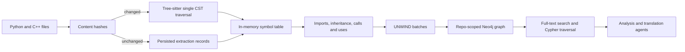

# graph-n4j

Build repository-scoped Python and C++ code graphs in Neo4j and query them through
CodexGraph's analysis and Cypher translation agents.

## Install and configure

Requires Python 3.10+ and Neo4j 5+. Tree-sitter grammars ship as wheels; no local
parser compilation is needed on supported wheel platforms.

```bash
pip install .
docker run -d --name graph-n4j-db -p 127.0.0.1:7687:7687 \
  -p 127.0.0.1:7474:7474 -e NEO4J_AUTH=neo4j/change-this-password neo4j:5-community
export NEO4J_URI=bolt://localhost:7687
export NEO4J_USER=neo4j
export NEO4J_PASSWORD=change-this-password
```

Indexing, statistics, and raw Cypher need only Neo4j. An LLM credential is needed
when asking questions. Environment variables can also be supplied in `.env`.

| Provider | Selection | Credential | Default model |
|---|---|---|---|
| Groq | `--provider groq` | `GROQ_API_KEY` | `llama-3.3-70b-versatile` |
| OpenAI | `--provider openai` | `OPENAI_API_KEY` | `gpt-4o` |
| Anthropic | `--provider anthropic` | `ANTHROPIC_API_KEY` | `claude-3-7-sonnet-latest` |
| Gemini | `--provider gemini` | `GEMINI_API_KEY` | `gemini-2.5-flash` |
| Ollama | `--provider ollama` | None | `qwen2.5-coder` |

Use `LLM_PROVIDER` for the default provider and `<PROVIDER>_MODEL` for its model.
Use `OLLAMA_HOST` to change the local server URL, default `http://localhost:11434`.
Pull an Ollama model before asking: `ollama pull qwen2.5-coder`.
Provider model availability depends on the account and service. Override the model
using `graph-n4j --model MODEL ask ...`; `o3-mini` is supported through the OpenAI
adapter with reasoning-compatible request parameters. The adapters share a small
HTTP transport except Groq, which retains its existing SDK implementation.

API references: [OpenAI](https://developers.openai.com/api/reference/resources/chat/subresources/completions/methods/create),
[Anthropic](https://platform.claude.com/docs/en/api/messages),
[Gemini](https://ai.google.dev/api/generate-content),
[Ollama](https://docs.ollama.com/api/chat).

## CLI

```bash
graph-n4j index ./python-project --repo-id python-project --stats
graph-n4j index ./cpp-project --repo-id cpp-project --stats
graph-n4j index-github pallets/click --stats
graph-n4j ask 'What calls parse_args?' --repo-id python-project --provider groq
graph-n4j --model qwen2.5-coder ask 'Explain main' --repo-id cpp-project --provider ollama
graph-n4j cypher 'MATCH (f1)-[:CALLS]->(f2) RETURN count(*)'
graph-n4j repos
graph-n4j stats --repo-id python-project
```

Supported extensions: `.py`, `.cpp`, `.hpp`, `.h`, `.cc`, `.cxx`, `.hxx`.
The default filter excludes tests, vendored code, large files, and build outputs.
`RepoManager.get_source_files()` accepts `FilterConfig` to customize filtering.
Use `index --legacy-2pass` for the retained Python AST implementation.

## Python API

```python
from graph_n4j import GraphN4J

with GraphN4J.from_env(provider="openai", model_override="gpt-4o") as graph:
    graph.index("./project", repo_id="project")
    candidates = graph.search_symbols("parse*", repo_id="project")
    result = graph.ask("What calls parse_args?", repo_id="project")
    print(result.answer)
```

`search_symbols` accepts Lucene full-text query syntax. The translation agent can
combine full-text entry points with graph traversal. Configure a translation model
with `GROQ_MODEL_TRANSLATION` for Groq or `LLM_TRANSLATION_MODEL` for other providers.

## Architecture



Nodes: MODULE, CLASS, FUNCTION, METHOD, FIELD, GLOBAL_VARIABLE.
Relationships: CONTAINS, HAS_METHOD, HAS_FIELD, INHERITS, USES, CALLS, IMPORTS.
Every identity includes `repo_id`; methods and fields also include `class_name`.
Schema initialization migrates the old global uniqueness constraints and propagates
schema errors instead of silently proceeding with an incomplete schema.

Incremental runs read SHA-256 hashes from MODULE nodes. Unchanged files reuse their
stored extraction without reparsing. Changed/deleted files invalidate reverse import
dependents; stale subgraphs are removed and affected incoming/outgoing edges rebuilt.
Unchanged graphs still receive the current commit metadata. Skeleton construction
uses one aggregated query.

Static analysis is conservative: dynamic dispatch, runtime imports, C++ macro
expansion and overload resolution are not compiler-complete. Ambiguous references
are left unresolved. No vector embedding service is configured by this release.

## Measured benchmark

20 deterministic Python files, isolated Neo4j 5 Community, separate worker processes:

| Metric | Legacy two-pass | Unified single-pass |
|---|---:|---:|
| File parse time | 0.0018 s | 0.0218 s |
| Resolution plus ingestion (legacy) | 0.6778 s | n/a |
| In-memory resolution | n/a | 0.0019 s |
| Batched ingestion | n/a | 0.1898 s |
| Total wall time | 0.6796 s | 0.2141 s |
| Peak process RSS | 78.06 MB | 78.73 MB |
| Database transactions | 280 | 17 |
| Nodes | 140 | 140 |
| Edges | 140 | 180 |

Measured synthetic speedup: 3.17x. All legacy node/edge identities
were retained and 40 CALLS edges were added. Legacy resolution interleaves writes,
so the runner does not invent separate resolution and ingestion timings.

The same filtered 17-file source set from pallets/click at commit
`8abb77a8432e03ed14a95f972b44f905279415a7` indexed in 0.5539 s versus
7.1816 s (12.97x faster), with 28 versus 3,596 transactions. The unified graph
contained 1,054 nodes and 3,343 edges, including 363 CALLS edges, with zero missing
legacy nodes or edges. Peak RSS was 124.45 MB versus 90.16 MB. Both engines use
the same repository filters. The legacy resolver's unrelated-global-name collision
was corrected before this comparison; all results reflect that correction.

These are measured local results, not a general 100x claim. SWE-bench task-solving
validation is deferred at the user's request. Provider adapters were checked using
mocked HTTP responses; live provider availability and credentials were not tested.
Machine-readable synthetic identities and timings are in `benchmarks/results.json`;
Click measurements and parity are in `benchmarks/click_summary.json` and
`benchmarks/click_report.txt`.

```bash
NEO4J_URI=bolt://localhost:7687 python -m benchmarks.run_benchmark --files 20
python -m benchmarks.run_benchmark --repo ./python-project --output benchmarks/project.json
```

The runner clears only its own `graph-n4j-benchmark-*` repository IDs. C++ indexing
is verified separately because the legacy implementation supports Python only.

## Development and releases

```bash
pip install '.[dev]'
pytest tests/
ruff check .
mypy graph_n4j
```

To include Neo4j integration tests, set `GRAPH_N4J_TEST_URI` to a disposable server
with username `neo4j` and password `graphn4jtest`. Tests clean their own repo IDs.
Provider tests use mocked HTTP transport and require no paid API calls.

`scripts/bump_version.py patch|minor|major` synchronizes package metadata and
`_version.py`, regenerates CHANGELOG.md from git history, and stages those files.
Do not edit the generated changelog by hand. Release commits use Conventional Commits.
