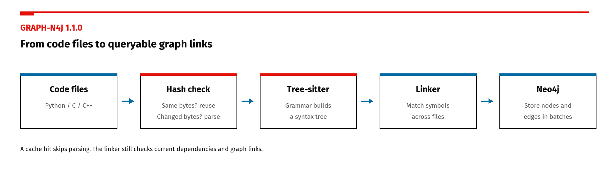
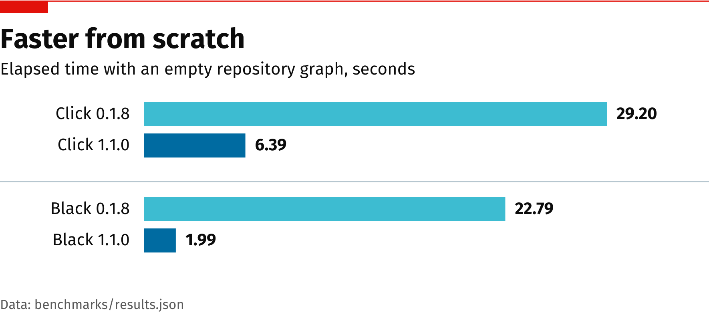
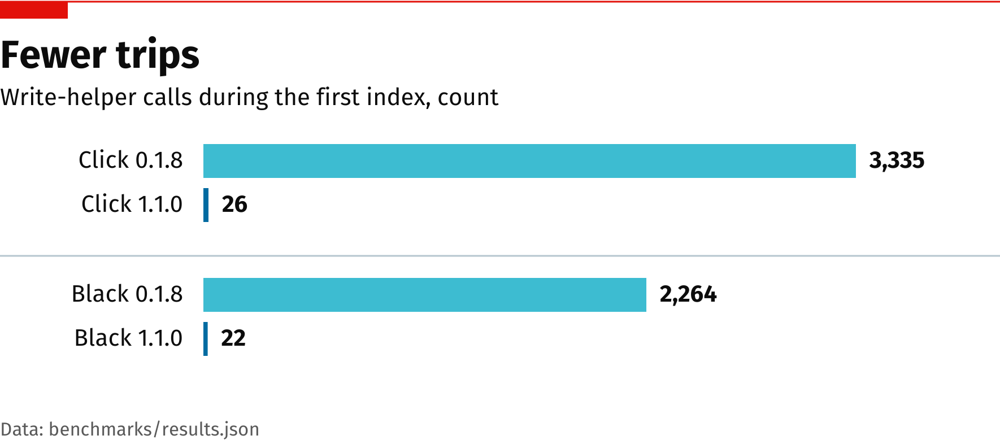
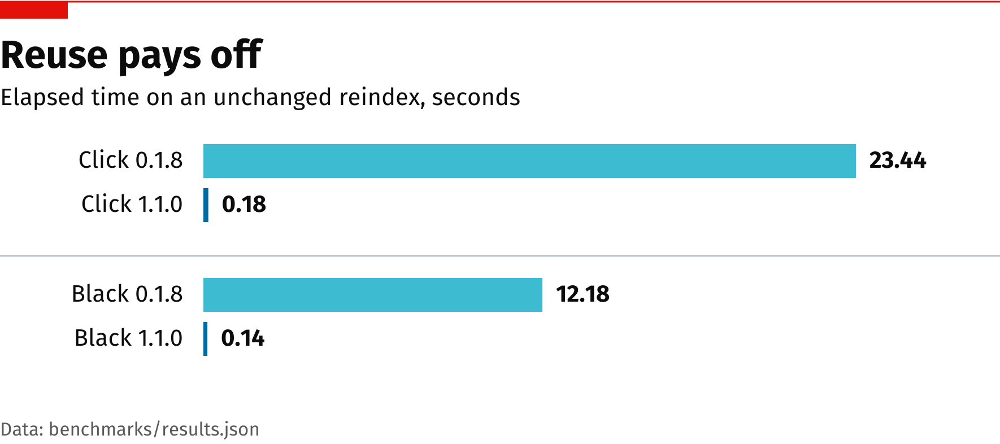
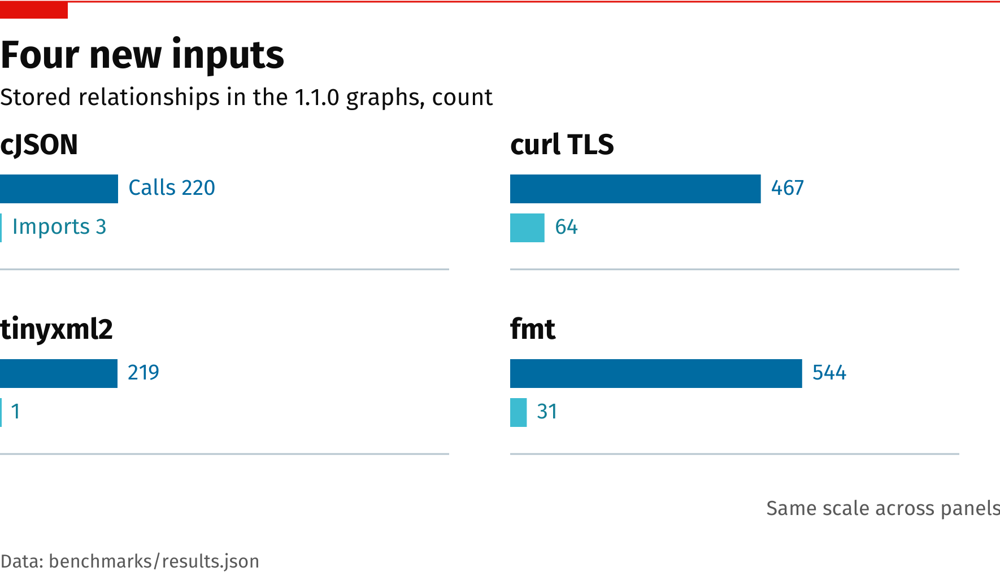

# graph-n4j

Index Python, C and C++ code in Neo4j, then query relationships between files, classes and functions. Version 1.1.1 republishes the 1.1.0 indexer with an expanded README. The indexer uses Tree-sitter grammars, SHA-256 file checks, a cross-file linker and batched graph writes.



## How indexing works

The indexer reads selected files and calculates a SHA-256 digest for each one. If the saved digest, extractor version and extracted records still match, it restores the saved records. Otherwise, Tree-sitter parses the whole changed file with the grammar for Python, C or C++.

The parsers emit symbols, such as functions and classes, plus references, such as a call whose target still needs to be found. The linker matches those names across files. The writer sends the resulting graph records to Neo4j in batches.

A cache hit skips parsing. It does not skip linking or dependency checks. If a changed file affects an importer, graph links for both files may need refreshing. This project does not use Tree-sitter's edit-by-edit parsing API.

| Graph item | Labels or relationships |
| --- | --- |
| Code symbols | `MODULE`, `CLASS`, `FUNCTION`, `METHOD`, `FIELD`, `GLOBAL_VARIABLE` |
| Relationships | `CONTAINS`, `HAS_METHOD`, `HAS_FIELD`, `INHERITS`, `USES`, `CALLS`, `IMPORTS` |

## Worked example

The call is in `checkout.py`; the function is in `rates.py`:

```python
# checkout.py
from rates import discount

def quote(total):
    return discount(total)

# rates.py
def discount(total):
    return total - 5
```

The parser records the call name `discount`. The import points to `rates.py`, and the linker resolves the name to the function there. The graph can then store a `CALLS` edge that a Cypher query can follow:

```cypher
MATCH (q:FUNCTION {repo_id: $repo, name: 'quote'})-[:CALLS]->(f)
RETURN f.name AS callee, f.file_path AS file
```

## What changed since 0.1.8

The published 0.1.8 release used Python's built-in AST, handled Python files only and completed relationships in a second pass. Version 1.1.0 uses Tree-sitter for Python, C and C++, reuses unchanged file extraction, resolves references across files, and sends graph records to Neo4j in batches.

Only Click and Black can be compared across both versions because 0.1.8 does not support C or C++. The C and C++ results below were measured with 1.1.0 only.

## Benchmark results

We used pinned source revisions and measured a first index from an empty repository graph, followed by an unchanged repeat. Times include reading and hashing files, parsing or restoring records, linking, and Neo4j writes. They exclude checkout, database setup and graph inspection. The release run has one observation per case; a separate Click follow-up includes three trials. All timings come from one machine.

| Selection | Language | Files | 0.1.8 first / repeat (s) | 1.1.0 first / repeat (s) | Write calls, 0.1.8 first / repeat | Write calls, 1.1.0 first / repeat |
| --- | --- | ---: | ---: | ---: | ---: | ---: |
| Click | Python | 16 | 29.20 / 23.44 | 6.39 / 0.18 | 3,335 / 3,335 | 26 / 1 |
| Black | Python | 25 | 22.79 / 12.18 | 1.99 / 0.14 | 2,264 / 2,264 | 22 / 1 |
| cJSON | C | 4 | Unsupported | 0.84 / 0.08 | Unsupported | 17 / 1 |
| curl TLS | C | 31 | Unsupported | 2.59 / 0.16 | Unsupported | 25 / 1 |
| tinyxml2 | C++ | 2 | Unsupported | 0.83 / 0.04 | Unsupported | 20 / 1 |
| fmt | C++ | 17 | Unsupported | 3.19 / 0.13 | Unsupported | 26 / 1 |

“Write calls” counts calls to the project's Neo4j write helpers. One helper call can submit many graph records. It is not a count of nodes, edges or physical disk writes. On an unchanged 1.1.0 run, files are still read and hashed, records are linked again, and the revision stamp is updated.

### First-index time



### Database write calls



### Unchanged reindex time



### Native-language graph coverage



These results compare complete indexing paths. Parser support, linking, graph records, cache reuse and database writes changed together, so the timings do not isolate Tree-sitter's effect. Edge counts describe stored relationships, not correctness scores. We did not measure precision or recall against a labelled set of expected edges.

The benchmark table and figures are shown here. Machine-readable measurements are available in [benchmark-results.json](https://raw.githubusercontent.com/ShubhamKumarSahu-svg/graph-n4j/main/docs/benchmark-results.json).

## Install and run

Install graph-n4j:

```bash
pip install graph-n4j
```

Start a local Neo4j instance for development:

```bash
docker run -d --name graph-n4j-db \
  -p 7687:7687 -p 7474:7474 \
  -e NEO4J_AUTH=neo4j/change-me \
  neo4j:5-community
```

Set the database connection and a provider key for natural-language questions:

```bash
export NEO4J_URI=bolt://localhost:7687
export NEO4J_USER=neo4j
export NEO4J_PASSWORD=change-me
export GROQ_API_KEY="gsk_your_key"
```

Index a local project or a public GitHub repository, then ask a question:

```bash
graph-n4j index ./project --repo-id example/project --stats
graph-n4j index-github pallets/click --stats
graph-n4j ask "Where is command routing handled?" --repo-id pallets/click --provider groq
```

For direct graph access, use Cypher:

```bash
graph-n4j cypher "MATCH (c:CLASS) RETURN c.name LIMIT 10"
```

## Python API

```python
from graph_n4j import GraphN4J

with GraphN4J.from_env(provider="groq") as graph:
    graph.index_github("pallets/click")
    answer = graph.ask(
        "Where is command routing handled?",
        repo_id="pallets/click",
    )
    print(answer.answer)
```

Neo4j is required for indexing and graph queries. A language-model provider key is needed for natural-language `ask` requests. Direct Cypher queries do not need a model provider.

## License

MIT. See [LICENSE](LICENSE).

