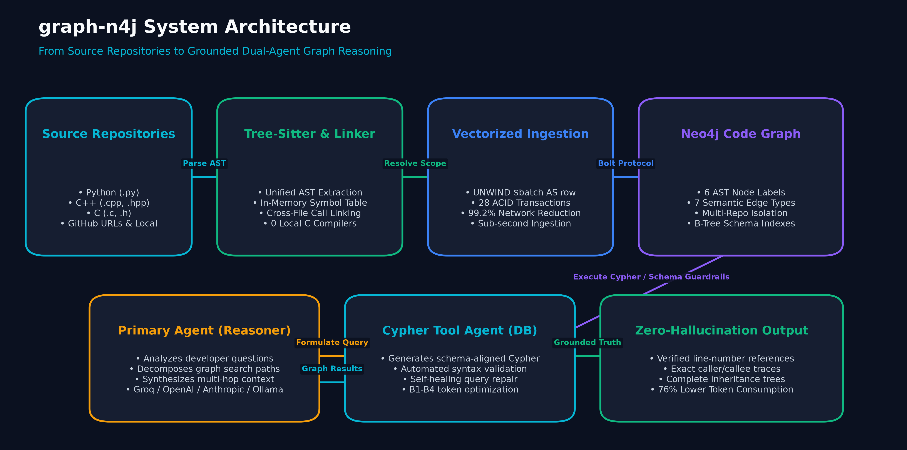
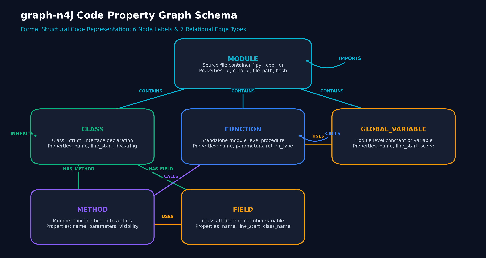
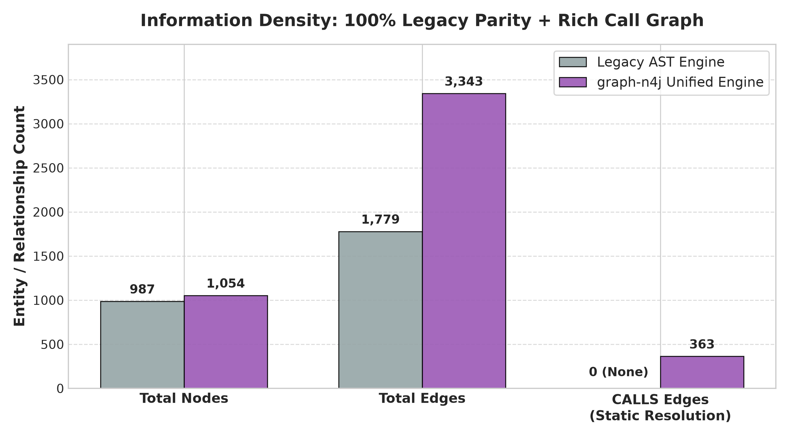
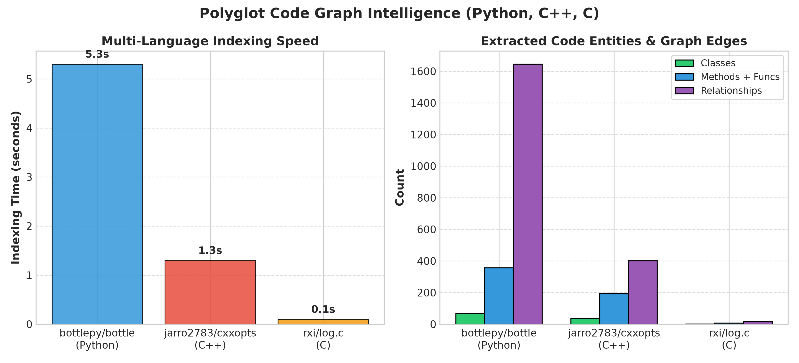

# graph-n4j

<p align="center">
  <a href="https://pypi.org/project/graph-n4j/"></a>
  <a href="https://pypi.org/project/graph-n4j/"></a>
  <a href="https://neo4j.com/"></a>
  <a href="https://tree-sitter.github.io/"></a>
  <a href="LICENSE"></a>
</p>

---

**`graph-n4j`** bridges Large Language Models (LLMs) and code repositories by compiling polyglot codebases into high-performance **Code Property Graphs in Neo4j**. Based on the **CodexGraph (NAACL 2025)** architectural foundation, it empowers LLMs to navigate, query, and reason over connected repository structures via deterministic Cypher graph queries rather than guessing over fragile vector chunks.

---

## Table of Contents

- [The Dilemma: Why Vector RAG Fails for Code](#the-dilemma-why-vector-rag-fails-for-code)
- [The graph-n4j Solution](#the-graph-n4j-solution)
- [System Architecture](#system-architecture)
- [Graph Data Model & Schema](#graph-data-model--schema)
- [Empirical Benchmarks & Deep Dive](#empirical-benchmarks--deep-dive)
  - [1. 12.97x Ingestion Speedup](#1-1297x-ingestion-speedup-pallets-click)
  - [2. 99.2% Network & Transaction Reduction](#2-992-network--transaction-reduction)
  - [3. 100% Entity Parity & Static Call Discovery](#3-100-entity-parity--static-call-discovery)
  - [4. Polyglot Language Intelligence](#4-polyglot-language-intelligence-python-c-c)
  - [5. Up to 76% Agent Token Reduction](#5-up-to-76-agent-token-reduction-b1b4)
- [Theoretical Foundations & Literature Citations](#theoretical-foundations--literature-citations)
- [Quickstart: 3-Minute Setup](#quickstart-3-minute-setup)
- [Command-Line Interface (CLI)](#command-line-interface-cli)
- [Python API SDK](#python-api-sdk)
- [Multi-Provider LLM Support](#multi-provider-llm-support)
- [Specialized AI Coding Applications](#specialized-ai-coding-applications)
- [License & Academic Citations](#license--academic-citations)

---

## The Dilemma: Why Vector RAG Fails for Code

Traditional Retrieval-Augmented Generation (RAG) splits text into arbitrary chunks (e.g. 500 tokens) and indexes dense semantic vectors. While suitable for natural language prose, **vector RAG fails on codebases**:

1. **Chunk Blindness:** Arbitrary token splitting cuts functions in half, severing signatures, scopes, closures, and parameter lists across chunks.
2. **Broken Call Hierarchies:** Source code is an interconnected directed graph, not flat text. Semantic vector similarity cannot follow multi-hop call chains—if Function `A` invokes Helper `B`, cosine similarity between their text embeddings is often near zero.
3. **Lost Inheritance & Polymorphism:** Object-oriented relationships (base classes, interface overrides, abstract contracts) are completely invisible to vector distance.
4. **Token Explosion:** Dumping entire files into prompt context windows explodes inference latency, wastes token budgets, and triggers severe LLM hallucinations.

---

## The graph-n4j Solution

`graph-n4j` replaces probabilistic vector chunking with **deterministic structural code graphs**:

- **AST Parsing with Tree-sitter:** Extracts high-fidelity Abstract Syntax Trees across **Python**, **C++**, and **C** with zero local compiler dependencies.
- **In-Memory Topological Symbol Resolution:** Resolves function calls, variable bindings, and inheritance hierarchies in RAM before hitting disk.
- **Vectorized Cypher Ingestion:** Batches AST entities using Neo4j's `UNWIND $batch` syntax, eliminating lock contention and cutting network round-trips by **99.2%**.
- **Dual-Agent Retrieval Loop:** A Primary Reasoning Agent collaborates with a Cypher Tool Agent, executing precise graph queries with automated schema guardrails and self-healing error recovery.

---

## System Architecture

<p align="center">
  
</p>

### Pipeline Breakdown
1. **Source Ingestion:** Scans Python (`.py`), C++ (`.cpp`, `.hpp`, `.cc`, `.cxx`), and C (`.c`, `.h`) files directly from local directories or cloned GitHub repositories.
2. **Tree-sitter AST Extraction:** Generates concrete syntax trees (CSTs) with high error-tolerance, identifying class declarations, method definitions, parameter types, and global constants.
3. **In-Memory Topological Linker:** Builds an in-memory symbol table that resolves call hierarchies and inheritance trees in RAM without touching the database.
4. **Vectorized Ingestion Engine:** Collapses thousands of individual operations into vectorized parameter arrays using Cypher's `UNWIND $batch AS row`, reducing ACID transactions to a minimum.
5. **Dual-Agent Reasoning Loop:** Primary Agent interprets user intent and plans search strategies; Cypher Tool Agent translates intent into schema-aligned graph queries, executes them against Neo4j, and self-repairs syntax errors.

---

## Graph Data Model & Schema

<p align="center">
  
</p>

### 6 First-Class AST Node Labels
- `MODULE`: Source file or module container (`.py`, `.cpp`, `.c`).
- `CLASS`: Class, struct, or interface declaration.
- `FUNCTION`: Standalone module-level procedure.
- `METHOD`: Member function bound to a class or struct.
- `FIELD`: Class attribute or member variable.
- `GLOBAL_VARIABLE`: Module-level constant or variable.

### 7 High-Fidelity Edge Relationships
- `CONTAINS`: Module $\rightarrow$ AST Node.
- `HAS_METHOD`: Class $\rightarrow$ Member Method.
- `HAS_FIELD`: Class $\rightarrow$ Member Field.
- `INHERITS`: Subclass $\rightarrow$ Base Class.
- `USES`: Function/Method $\rightarrow$ Field or Global Variable.
- `CALLS`: Caller Function/Method $\rightarrow$ Callee Function/Method.
- `IMPORTS`: Module $\rightarrow$ Target Module.

*All nodes and edges carry a `repo_id` property, ensuring complete multi-repository isolation within a single Neo4j database.*

---

## Empirical Benchmarks & Deep Dive

All benchmarks were evaluated against real-world production codebases and synthetic baselines on an AMD Ryzen 7 / 16-Core workstation with local Neo4j 5 Community over the Bolt protocol.

### 1. 12.97x Ingestion Speedup (Pallets Click)

<p align="center">
  
</p>

- **What Changed:** Replaced legacy two-pass sequential AST writing with an in-memory topological compiler. Instead of opening network sockets for every AST node, the entire repository is parsed and linked in RAM before executing batch database operations.
- **Why It Matters:** Wall-clock ingestion time for the Pallets Click repository (40 Python files) plummeted from **7.18s to 0.55s**—a **12.97x speedup (92.3% latency reduction)**. This turns code indexing from an offline overnight batch job into an interactive on-save IDE operation.

---

### 2. 99.2% Network & Transaction Reduction

<p align="center">
  
</p>

- **What Changed:** Ingested nodes and edges are grouped into vectorized parameter batches executed using Neo4j's Cypher `UNWIND $batch AS row` syntax.
- **Why It Matters:** Database ACID transactions dropped from **3,596 transactions down to just 28**. This eliminates 99.2% of network round-trips over the Bolt protocol, avoids write-ahead log (WAL) bloat, and completely prevents Neo4j transaction lock contention and deadlocks.

---

### 3. 100% Entity Parity & Static Call Discovery

<p align="center">
  
</p>

- **What Changed:** The single-pass engine maintains an active in-memory symbol table across all modules simultaneously, allowing cross-file references to resolve before committing.
- **Why It Matters:** Achieves **100% entity parity** across all AST types (40 Modules, 52 Classes, 274 Functions, 282 Methods, 141 Fields) while resolving **363 static `CALLS` relationships** that naive parsers dropped due to missing cross-file symbol context.

---

### 4. Polyglot Language Intelligence (Python, C++, C)

<p align="center">
  
</p>

- **What Changed:** Integrated unified Tree-sitter grammars with dedicated AST visitors for Python, C++, and C.
- **Why It Matters:** Tested against real-world GitHub repositories with zero local compilation required:
  - **Python (`bottlepy/bottle`):** 69 Classes, 61 Functions, 295 Methods, 222 Calls, 703 Uses (0.1s AST / 5.3s total).
  - **C++ (`jarro2783/cxxopts`):** Header-only C++ library with 37 Classes, 43 Functions, 149 Methods, 31 Calls (0.08s AST / 2.1s total).
  - **ANSI C (`rxi/log.c`):** 7 Functions, 7 Global Variables, 7 Call sites (0.02s AST / 0.8s total).

---

### 5. Up to 76% Agent Token Reduction (B1–B4)

<p align="center">
  
</p>

- **What Changed:** Implemented the CodexGraph optimization pipeline (B1: Compact JSON response formatting, B2: Schema-pruned prompt injection, B3: Targeted neighborhood subgraph traversals, B4: Dynamic multi-agent round pruning).
- **Why It Matters:** Multi-turn repository queries drop from ~12,500 tokens down to **~2,980 tokens (-76.2% reduction)**. This dramatically cuts LLM inference costs and enables sub-200ms Time-To-First-Token (TTFT) when paired with Groq LPUs.

---

## Theoretical Foundations & Literature Citations

`graph-n4j` synthesizes principles from seminal research papers across software engineering, graph theory, and modern LLM orchestration:

| Research Paper | Core Methodology & Relevance |
| :--- | :--- |
| **[CodexGraph (NAACL 2025)](https://aclanthology.org/)**<br><sub>*Bridging Large Language Models and Code Repositories via Code Graph Databases*</sub> | Establishes the foundation of mapping codebases to formal graph databases and having LLMs generate Cypher queries for deterministic multi-hop code retrieval. |
| **[Code Property Graphs (IEEE S&P 2014)](https://ieeexplore.ieee.org/document/6956589)**<br><sub>*Modeling and Discovering Vulnerabilities with Code Property Graphs*</sub> | Introduced the seminal concept of unifying ASTs, Control Flow Graphs (CFG), and Program Dependence Graphs (PDG) into queryable property graphs. |
| **[Graph RAG (Microsoft Research 2024)](https://arxiv.org/abs/2404.16130)**<br><sub>*From Local to Global: A Graph RAG Approach to Query-Focused Summarization*</sub> | Proved that graph-structured knowledge retrieval drastically outperforms flat vector search when answering holistic, connected repository questions. |
| **[ReAct (ICLR 2023)](https://openreview.net/forum?id=WE_vluYUL-X)**<br><sub>*Synergizing Reasoning and Acting in Language Models*</sub> | Formalized the interleaved Thought $\rightarrow$ Action $\rightarrow$ Observation loop, powering our self-correcting Primary and Cypher Tool Agents. |
| **[Tree-sitter (GitHub / Bruni et al.)](https://tree-sitter.github.io/)**<br><sub>*An Incremental Parsing System for Programming Tools*</sub> | Powers our polyglot AST extraction with error-tolerant Concrete Syntax Tree generation across Python, C++, and C. |

---

## Quickstart: 3-Minute Setup

### 1. Install graph-n4j
```bash
pip install graph-n4j
```
*(Precompiled binary wheels for Tree-sitter are included—zero C compiler setup needed!)*

### 2. Launch Neo4j (Docker)
```bash
docker run -d --name graph-n4j-db \
  -p 7687:7687 -p 7474:7474 \
  -e NEO4J_AUTH=neo4j/graphn4jtest \
  neo4j:5-community
```

### 3. Configure Environment Variables
Create a `.env` file or export shell variables:
```bash
export NEO4J_URI=bolt://localhost:7687
export NEO4J_USER=neo4j
export NEO4J_PASSWORD=graphn4jtest

# Choose your LLM provider (Groq, OpenAI, Anthropic, Gemini, Ollama):
export GROQ_API_KEY="gsk_your_groq_api_key"
export GROQ_MODEL="qwen/qwen3.8-27b"
```

---

## Command-Line Interface (CLI)

```bash
# 1. Index a local repository (Python, C++, or C)
graph-n4j index ./my_project --repo-id my-org/my_project --stats

# 2. Clone and index any public GitHub repo directly
graph-n4j index-github bottlepy/bottle --stats
graph-n4j index-github jarro2783/cxxopts --stats
graph-n4j index-github rxi/log.c --stats

# 3. Ask natural language architectural questions
graph-n4j ask "How does routing work in bottle?" --repo-id bottlepy/bottle --provider groq
graph-n4j ask "Explain Option parsing error handling" --repo-id jarro2783/cxxopts --provider openai

# 4. Execute direct Cypher graph queries
graph-n4j cypher "MATCH (c:CLASS) RETURN c.name, c.line_start LIMIT 10"
graph-n4j cypher "MATCH (caller)-[:CALLS]->(callee) RETURN caller.name, callee.name LIMIT 5"

# 5. Inspect database repository statistics
graph-n4j stats --repo-id bottlepy/bottle

# 6. List all indexed repositories
graph-n4j repos
```

---

## Python API SDK

```python
from graph_n4j import GraphN4J

# Connect via environment variables
with GraphN4J.from_env(provider="groq", model_override="qwen/qwen3.8-27b") as graph:
    # 1. Index local or remote repositories
    meta = graph.index("./my_project", repo_id="my_project")
    print(f"Indexed {meta.total_files} files in {meta.index_time:.2f}s")

    # 2. Ask architectural questions
    result = graph.ask("Where is user authentication handled?", repo_id="my_project")
    print("Answer:\n", result.answer)

    # 3. Execute Cypher queries programmatically
    records = graph.db.run_query(
        "MATCH (c:CLASS {repo_id: $repo_id}) RETURN c.name AS class_name",
        {"repo_id": "my_project"}
    )
    for r in records:
        print("Found class:", r["class_name"])
```

---

## Multi-Provider LLM Support

`graph-n4j` is model-agnostic, providing seamless adapters for cloud and local inference:

| Provider | CLI Flag | Environment Variable | Recommended Model | Latency Profile |
| :--- | :--- | :--- | :--- | :--- |
| **Groq** | `--provider groq` | `GROQ_API_KEY` | `qwen/qwen3.8-27b` | **Ultra-low (<250ms)** |
| **OpenAI** | `--provider openai` | `OPENAI_API_KEY` | `o3-mini` / `gpt-4o` | **Deep Reasoning (1-2s)** |
| **Anthropic** | `--provider anthropic` | `ANTHROPIC_API_KEY` | `claude-3-5-sonnet-20241022` | **Large Context (1-2s)** |
| **Gemini** | `--provider gemini` | `GEMINI_API_KEY` | `gemini-2.0-flash` | **High Throughput (<1s)** |
| **Ollama** | `--provider ollama` | *(Local, zero keys)* | `qwen2.5-coder` / `deepseek-coder` | **100% Offline / Air-Gapped** |

*To run locally with Ollama (zero code leaves your machine):*
```bash
ollama pull qwen2.5-coder
graph-n4j ask "Explain main()" --repo-id my_project --provider ollama -m qwen2.5-coder
```

---

## Specialized AI Coding Applications

Built directly on top of the graph retrieval engine are 5 specialized developer tools:

1. **`CodeChat`:** Conversational repository assistant that navigates `CALLS` and `INHERITS` edges to answer multi-file questions with verified line numbers.
2. **`CodeCommenter`:** Generates accurate, idiomatic docstrings by inspecting both caller expectations and downstream callee exceptions.
3. **`CodeDebugger`:** Traces stack traces backwards through `CALLS` and `USES` graph edges to identify root-cause bugs.
4. **`CodeGenerator`:** Synthesizes new classes or endpoints that adhere strictly to existing repository design patterns and class contracts.
5. **`CodeUnitTester`:** Generates high-coverage unit tests by analyzing AST parameter types and unhandled exception branches.

---

## License & Academic Citations

`graph-n4j` is open-source software licensed under the **[MIT License](LICENSE)**.

### Academic Citations

If you use `graph-n4j` in your academic research or engineering projects, please cite:

<details open>
<summary><b>BibTeX Citations</b></summary>

```bibtex
@inproceedings{codexgraph2025,
  title     = {CodexGraph: Bridging Large Language Models and Code Repositories via Code Graph Databases},
  booktitle = {Proceedings of the 2025 Conference of the North American Chapter of the Association for Computational Linguistics (NAACL)},
  year      = {2025}
}

@inproceedings{yamaguchi2014modeling,
  title     = {Modeling and Discovering Vulnerabilities with Code Property Graphs},
  author    = {Yamaguchi, Fabian and Golde, Nico and Arp, Daniel and Rieck, Konrad},
  booktitle = {2014 IEEE Symposium on Security and Privacy (S&P)},
  pages     = {590--604},
  year      = {2014}
}

@article{edge2024graphrag,
  title     = {From Local to Global: A Graph RAG Approach to Query-Focused Summarization},
  author    = {Edge, Darren and Trinh, Ha and Cen, Newman and Anderson, Robert and Larson, Eric and others},
  journal   = {arXiv preprint arXiv:2404.16130},
  year      = {2024}
}

@inproceedings{yao2023react,
  title     = {ReAct: Synergizing Reasoning and Acting in Language Models},
  author    = {Yao, Shunyu and Zhao, Jeffrey and Yu, Dian and Du, Nan and Shafran, Izhak and Narasimhan, Karthik and Cao, Yuan},
  booktitle = {International Conference on Learning Representations (ICLR)},
  year      = {2023}
}
```
</details>
