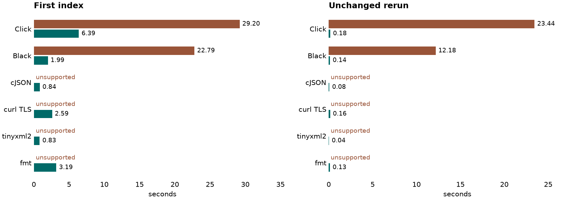
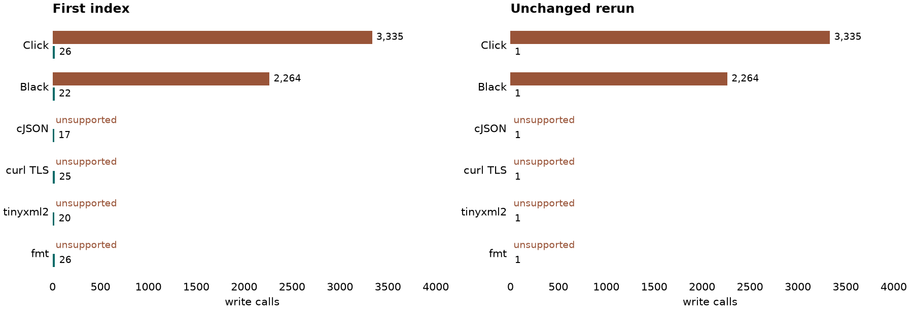
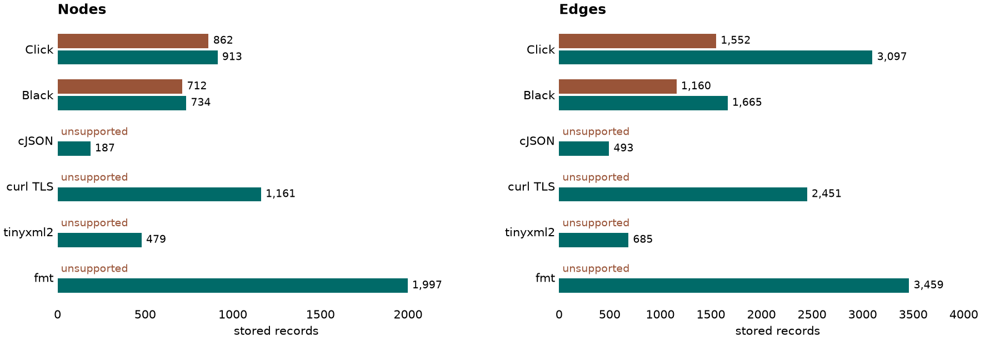

# From Python AST to a repository graph

On Click, both releases recover the inheritance edge from Group to MultiCommand. The new indexer also stores calls and imports, and reuses the parse of every unchanged file on the second run.

## Inputs and method

Python 3.12.12 on Windows-11-10.0.26300-SP0 with Neo4j 5.26.33. Each case ran in its own Python process. Both releases saw the same selected library sources. Each supported case started with an empty repository graph and immediately repeated the index. Setup, cloning, schema creation and graph inspection are outside the timer. Schema and database server caches could be warm.

The benchmark calls the two indexing stages from the published 0.1.8 wheel and the candidate UnifiedIndexer. It supplies the same repository and commit identifiers to both writers. Version 0.1.8 accepts Python files only. Unsupported inputs are excluded from its timing series. The corpus comprises production source selections, including the TLS component of curl. Each time is one observation. No memory, energy, model latency or token savings were measured.

| Source snapshot | Selection | Files | Source KiB |
| --- | --- | ---: | ---: |
| [pallets/click at 8.1.8](https://github.com/pallets/click/tree/934813e4d421071a1b3db3973c02fe2721359a6e) | src/click | 16 | 351.7 |
| [psf/black at 24.10.0](https://github.com/psf/black/tree/1b2427a2b785cc4aac97c19bb4b9a0de063f9547) | src/black | 25 | 431.0 |
| [DaveGamble/cJSON at v1.7.18](https://github.com/DaveGamble/cJSON/tree/acc76239bee01d8e9c858ae2cab296704e52d916) | cJSON and utilities | 4 | 141.3 |
| [curl/curl at curl-8_10_1](https://github.com/curl/curl/tree/7eb8c048470ed2cc14dca75be9c1cdae7ac8498b) | lib/vtls | 31 | 838.0 |
| [leethomason/tinyxml2 at 10.0.0](https://github.com/leethomason/tinyxml2/tree/321ea883b7190d4e85cae5512a12e5eaa8f8731f) | tinyxml2.cpp and header | 2 | 149.9 |
| [fmtlib/fmt at 11.0.2](https://github.com/fmtlib/fmt/tree/0c9fce2ffefecfdce794e1859584e25877b7b592) | include/fmt and src/*.cc | 17 | 599.1 |

## Measured results

| Input | Version | First (s) | Repeat (s) | Writes, first / repeat | Files reused | Nodes | Edges |
| --- | --- | ---: | ---: | ---: | ---: | ---: | ---: |
| Click | 0.1.8 | 29.20 | 23.44 | 3,335 / 3,335 | 0 | 862 | 1,552 |
| Click | 1.1.0 | 6.39 | 0.18 | 26 / 1 | 16 | 913 | 3,097 |
| Black | 0.1.8 | 22.79 | 12.18 | 2,264 / 2,264 | 0 | 712 | 1,160 |
| Black | 1.1.0 | 1.99 | 0.14 | 22 / 1 | 25 | 734 | 1,665 |
| cJSON | 0.1.8 | Unsupported | — | — | — | — | — |
| cJSON | 1.1.0 | 0.84 | 0.08 | 17 / 1 | 4 | 187 | 493 |
| curl TLS | 0.1.8 | Unsupported | — | — | — | — | — |
| curl TLS | 1.1.0 | 2.59 | 0.16 | 25 / 1 | 31 | 1,161 | 2,451 |
| tinyxml2 | 0.1.8 | Unsupported | — | — | — | — | — |
| tinyxml2 | 1.1.0 | 0.83 | 0.04 | 20 / 1 | 2 | 479 | 685 |
| fmt | 0.1.8 | Unsupported | — | — | — | — | — |
| fmt | 1.1.0 | 3.19 | 0.13 | 26 / 1 | 17 | 1,997 | 3,459 |

The brown series is 0.1.8 and the teal series is 1.1.0. A write is one call to the Neo4j write helper. The final counts come from queries against stored records after the unchanged rerun.

## Following Click through both indexers

In Click 8.1.8, core.py defines Group(MultiCommand). The original shallow pass uses Python ast to record Group and its base name. Edge completion looks up MultiCommand, writes each node and relationship with MERGE, and re-reads source when resolving uses. Both live graphs returned MultiCommand for Group in src/click/core.py.

The new parser records the class, its source span and the unresolved base reference together. The linker resolves that name against the repository symbol table. The writer groups the class with other classes and its inheritance edge with other edges of that type. The next index checks the file hash and extractor version, reloads cached records, relinks and updates the commit stamp. On Click it reused 16 files.

Click has 38 INHERITS edges in the baseline and 38 in the candidate. Version 1.1.0 also stores 301 CALLS and 58 IMPORTS edges. It stores 913 nodes versus 862. Counts describe what was indexed. The Group check validates one specific relationship. Neither result establishes recall or precision across the corpus.

## Release checks and limitations

The integration suite covers edits and deletions, cache reuse, cross-repository isolation, full-text lookup, C header lookup and C++ calls. Four HTTP provider adapters are tested with recorded-format synthetic responses. The five coding apps exercise two retrieval rounds with scripted model replies and a live database. These checks do not score generated answers or test hosted services.

Version 1.0.0 skipped .c files. The candidate registers the C grammar for .c and keeps the C++ grammar for .h. Both use the same graph vocabulary. For example, the cJSON result includes CLASS and METHOD labels for native declarations. Use source spans to check classifications. Static name resolution can miss dynamic targets, and a larger graph can contain extra or duplicate concepts.

See the [runner and exact file manifests](../benchmarks/) to reproduce this run.
